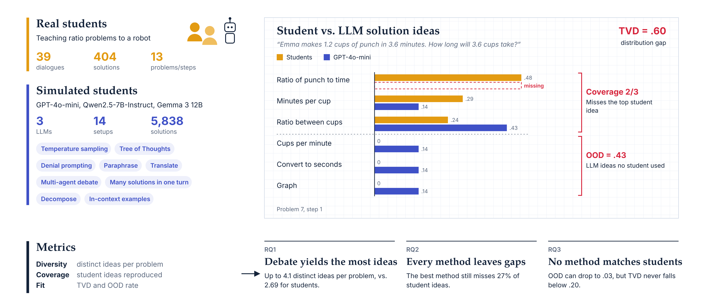

## Why it matters

Teams building tutoring products increasingly use LLMs as stand-ins for students: to generate practice data, to test a tutor before real users see it, or to simulate a class. Most prior work checks whether LLMs can imitate student mistakes. But students also differ in how they get to a correct answer, and a tutor that only expects one path will misjudge the rest.

## What I did

I annotated 404 correct student solutions from 39 conversations in which students taught math problems to a conversational robot, and 5,838 solutions from four LLMs: one proprietary, two open general-purpose, and one open math-specialized. I generated them with 13 prompting and sampling methods, including tree of thoughts, denial prompting, multi-agent debate, translation-based paraphrasing, and in-context learning. I then compared the distribution of solution strategies against the students’, using coverage and total variation distance.

## What I found

**No model and method pair covered all of the strategies students used**, and every pair over- or under-produced some strategy by at least 20 percentage points. That gap matters whenever LLMs stand in for students in system design and testing.
