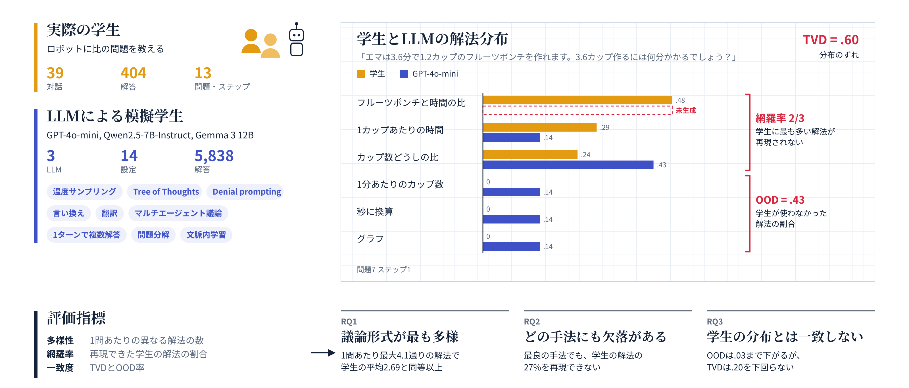

## なぜ重要か

教育サービスを開発するチームでは、LLMを生徒の代わりに使う場面が増えています。練習用データの生成、実際のユーザーに使ってもらう前のチューターのテスト、クラス全体のシミュレーションなどです。先行研究の多くは、LLMが生徒の間違いを再現できるかを検証してきました。しかし生徒は、正解にたどり着く道筋もそれぞれ異なります。1つの解き方しか想定していないチューターは、それ以外の解き方を正しく評価できません。

## 取り組んだこと

生徒が会話型ロボットに数学の問題を教えた39の対話から、生徒による正しい解答404件をアノテーションしました。さらに、4つのLLM（プロプライエタリなモデル1つ、オープンな汎用モデル2つ、オープンな数学特化モデル1つ）による5,838件の解答も分析しました。LLMの解答は、Tree of Thoughts、denial prompting、マルチエージェント討論、翻訳による言い換え、in-context learningなど、13のプロンプト・サンプリング手法で生成しました。そのうえで、解き方の分布を、カバー率と全変動距離（total variation distance）で生徒の分布と比較しました。

## わかったこと

**生徒が使ったすべての解き方を網羅できたモデルと手法の組み合わせは、一つもありませんでした**。また、どの組み合わせも、少なくとも1つの解き方を20ポイント以上多く、あるいは少なく生成していました。システムの設計やテストでLLMを生徒の代わりに使う場合、この差は見過ごせません。
